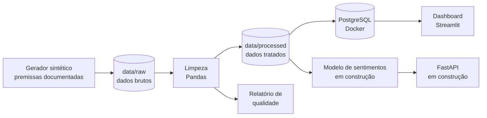
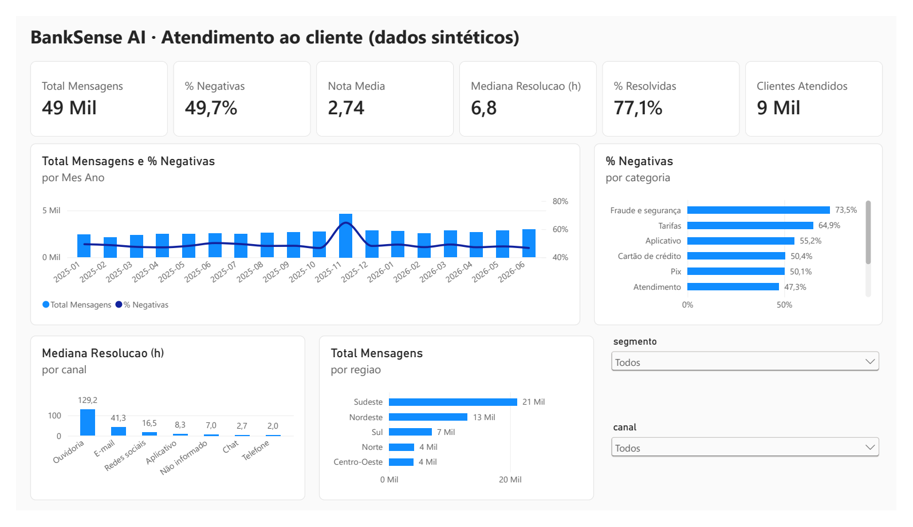
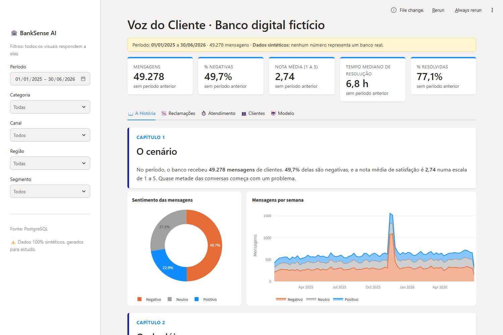
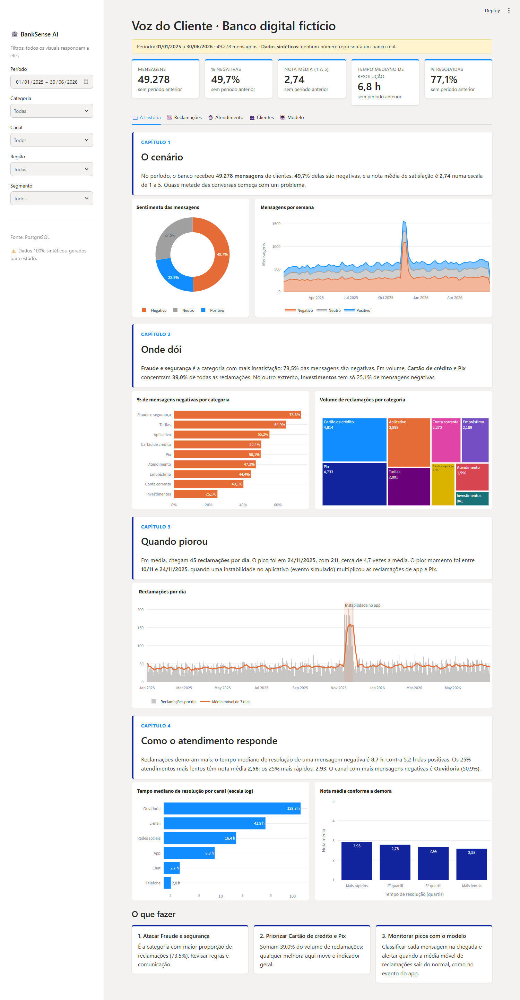
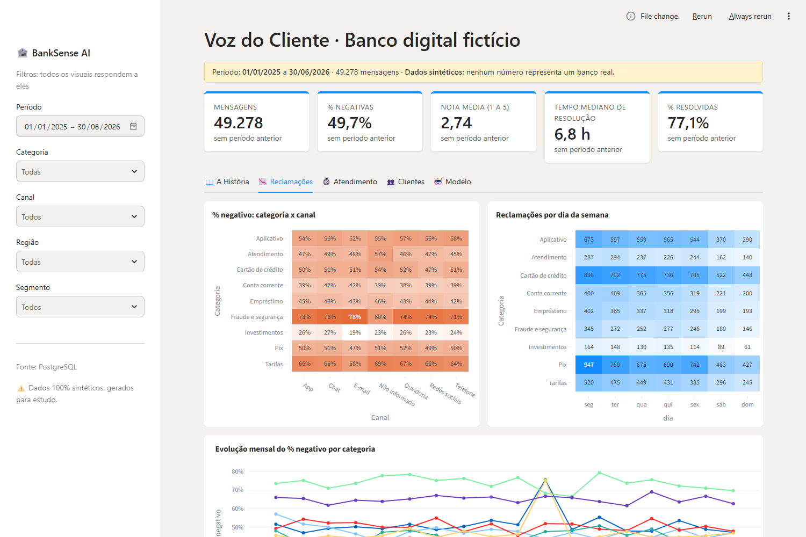
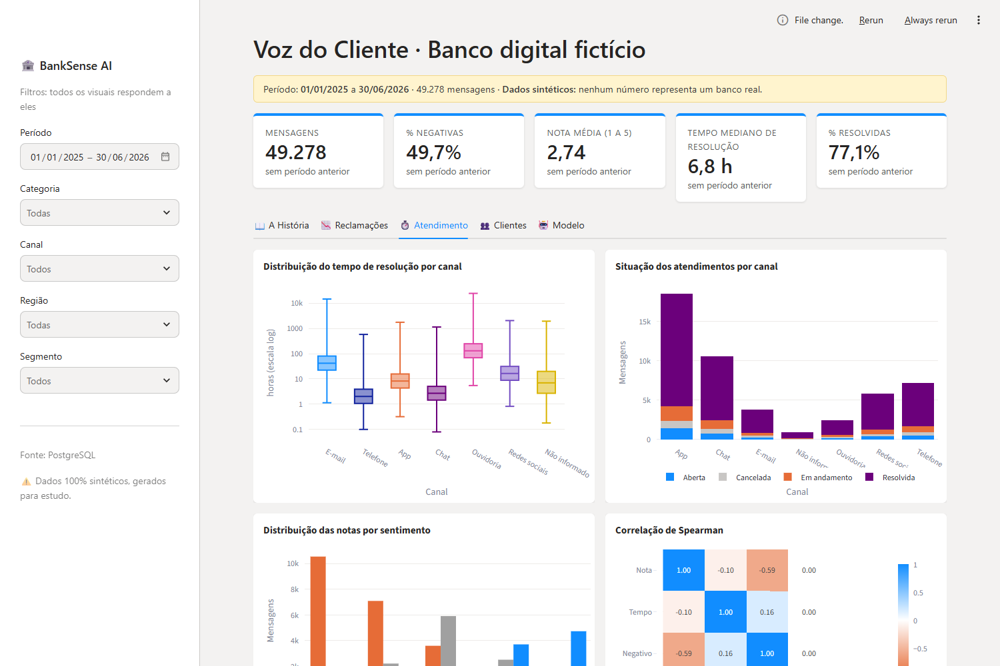
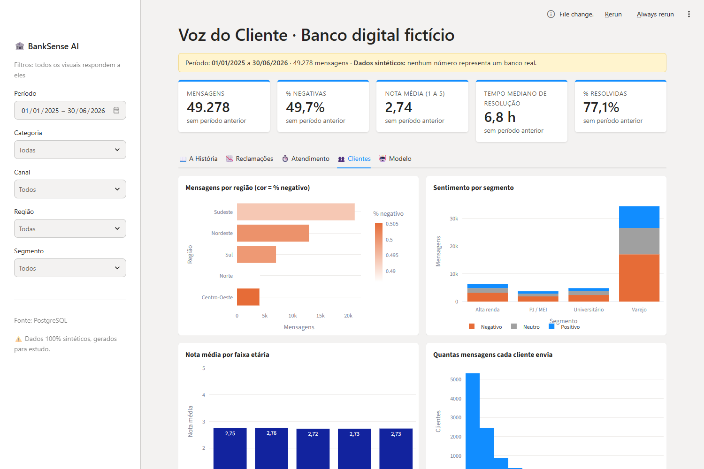

# BankSense AI · Banking Customer Intelligence

Pipeline completo de Ciência de Dados que analisa mensagens de clientes de um **banco digital brasileiro fictício**:
geração de dados, limpeza, banco de dados, estatística, Machine Learning e um dashboard executivo com storytelling.

> ⚠️ **Todos os dados são sintéticos**, gerados por um simulador com premissas documentadas.
> Nenhum resultado deste projeto representa bancos reais ou o mercado brasileiro.

🚧 **Projeto em construção, por etapas.** Situação atual:

| Etapa | Conteúdo | Situação |
|---|---|---|
| 1 | Infraestrutura (Docker + PostgreSQL) e gerador de dados sintéticos | ✅ |
| 2 | Limpeza de dados, relatório de qualidade e carga no banco | ✅ |
| 3 | Notebooks de estatística | ⏳ |
| 4 | Classificador de sentimentos e previsão de volume | ⏳ |
| 5 | API com FastAPI | ⏳ |
| 6 | Dashboard Streamlit | ✅ (análises) · ⏳ (aba do modelo) |
| 6b | Dashboard Power BI (DAX e star schema) | ✅ |
| 7 | Documentação final em português e inglês | ⏳ |

## O problema de negócio

Um banco digital recebe milhares de mensagens por dia em app, chat, telefone, e-mail, redes sociais e ouvidoria.
Ler tudo à mão é lento e caro, e os problemas só aparecem quando já viraram crise.
O BankSense AI organiza essas mensagens, mede a satisfação, encontra onde estão as dores e
(nas próximas etapas) classifica o sentimento automaticamente e prevê o volume de reclamações.

## Arquitetura



## Dados

- **50.000 mensagens** de **12.000 clientes**, de jan/2025 a jun/2026, em português com gírias, abreviações,
  erros de digitação, ironia e mensagens ambíguas.
- Problemas de qualidade inseridos de propósito para praticar limpeza: nulos, duplicatas, categorias escritas
  de vários jeitos, datas em formatos diferentes, notas fora da faixa e tempos negativos.
- Um evento simulado de instabilidade no aplicativo (10 a 24/11/2025) para a análise temporal.
- Todas as probabilidades estão em [`premissas.py`](src/banksense/dados/premissas.py) e documentadas em
  [`docs/premissas_geracao.md`](docs/premissas_geracao.md).

### Resultado da limpeza (valores reais desta execução)

| Item | Antes | Depois |
|---|---|---|
| Linhas | 50.616 | 49.278 |
| Escritas diferentes de canal | 40 | 6 |
| Escritas diferentes de região | 31 | 5 |
| Escritas diferentes de categoria | 48 | 9 |

Relatório completo: [`reports/qualidade_dados.md`](reports/qualidade_dados.md).

O pipeline registra **logs** (níveis INFO, WARNING e ERROR) no terminal e em `logs/banksense.log`:

```
2026-11-07 22:16:42 WARNING banksense.limpeza | Valores fora da faixa viraram nulo: 4 notas, 5 tempos negativos
2026-11-07 22:16:58 INFO    banksense.limpeza | Limpeza concluída: 50,616 brutas -> 49,278 tratadas
```

## BankSense no BigQuery (Google Cloud)

Os dados tratados também foram carregados no **BigQuery**, em um modelo **star schema**:

- `fato_mensagens`: 49.278 mensagens (tabela fato)
- `dim_clientes`: 12.000 clientes (dimensão)

As consultas ficam em [`sql/bigquery/01_consultas_iniciais.sql`](sql/bigquery/01_consultas_iniciais.sql)
(JOIN, GROUP BY, COUNTIF, mediana com `APPROX_QUANTILES` e função de janela com `ROW_NUMBER`).

Exemplo: a consulta de mensagens negativas por mês encontra sozinha o evento de instabilidade do aplicativo.

| Mês | Mensagens | % negativas | Sobre o aplicativo |
|---|---|---|---|
| 2025-10 | 2.722 | 46,6% | 324 |
| **2025-11** | **4.642** | **64,6%** | **1.320** |
| 2025-12 | 2.870 | 48,1% | 333 |

Para reproduzir: crie um dataset no BigQuery e carregue os arquivos Parquet de `data/processed/`
(pelo console: **Criar tabela → Fazer upload → Parquet**).

## Dashboard em Power BI

O mesmo star schema também virou um relatório no **Power BI Desktop** ([`powerbi/BankSense_Dashboard.pbix`](powerbi/BankSense_Dashboard.pbix)):



- **Modelo:** `fato_mensagens` ligada a `dim_clientes` e a uma tabela calendário criada em DAX (`dCalendario`), todas em relacionamento muitos para um.
- **Medidas DAX:** Total Mensagens (`COUNTROWS`), % Negativas e % Resolvidas (`CALCULATE` + `DIVIDE`), Nota Média, Mediana de Resolução (`MEDIAN`) e Clientes Atendidos (`DISTINCTCOUNT`).
- **Leitura:** o gráfico mensal mostra sozinho o pico de nov/2025 (instabilidade do aplicativo); fraude e segurança é a categoria com mais mensagens negativas; ouvidoria e e-mail são os canais mais lentos.
- **Filtros:** segmento do cliente e canal, aplicados à página inteira.

Os CSVs que o Power BI lê saem do script [`exportar_powerbi.py`](src/banksense/dados/exportar_powerbi.py), que traduz os rótulos e usa o formato brasileiro (`;` e vírgula decimal):

```bash
python -m banksense.dados.exportar_powerbi   # gera data/powerbi/*.csv
```

O `.pbix` já vem com os dados carregados. Para atualizar a partir da sua máquina, abra **Transformar dados → Configurações da fonte de dados** e aponte os dois CSVs para a sua pasta `data/powerbi/`.

## Dashboard

Estilo Power BI, com indicadores, filtros globais e uma página **"A História"** que conta, em 4 capítulos,
o cenário, onde estão as reclamações, quando pioraram e como o atendimento responde.
Os textos são calculados a partir dos dados filtrados.



<details>
<summary><b>Ver a página "A História" completa</b></summary>



</details>

| Reclamações | Atendimento | Clientes |
|---|---|---|
|  |  |  |

### Publicar no Render

O arquivo [`render.yaml`](render.yaml) já tem tudo configurado. Na nuvem não há PostgreSQL:
os dados são gerados e limpos durante a instalação (mesma semente, mesmo resultado) e o dashboard lê o arquivo tratado.

1. Crie uma conta em [render.com](https://render.com) entrando com o GitHub.
2. Clique em **New +** → **Blueprint** e escolha o repositório `banksense-ai`.
3. Confirme em **Apply**. O Render instala, gera os dados e coloca o dashboard no ar.

No plano gratuito, o serviço "dorme" depois de 15 minutos sem acesso; a primeira visita depois disso leva cerca de 1 minuto.

## Como rodar

Pré-requisitos: Python 3.11+ e Docker Desktop.

```bash
git clone https://github.com/TIAGODUMONT/banksense-ai.git
cd banksense-ai

python -m venv .venv
.venv\Scripts\activate            # Windows  (Linux/Mac: source .venv/bin/activate)
pip install -r requirements.txt
pip install -e .

docker compose up -d                       # PostgreSQL na porta 5433
python -m banksense.dados.gerador          # gera data/raw
python -m banksense.dados.limpeza          # gera data/processed e o relatório de qualidade
python -m banksense.db.carga               # aplica as migrations e carrega o banco
streamlit run dashboard/app.py             # abre o dashboard em http://localhost:8501

pytest                                     # testes
```

## Estrutura

```
banksense-ai/
├── dashboard/            # app Streamlit
├── powerbi/              # relatório Power BI (.pbix)
├── data/raw/             # dados brutos (gerados, fora do Git)
├── data/processed/       # dados tratados (gerados, fora do Git)
├── docs/                 # premissas da geração
├── reports/              # relatório de qualidade
├── sql/migrations/       # schema e índices
├── sql/bigquery/         # consultas no BigQuery
├── sql/consultas_exemplo.sql
├── src/banksense/
│   ├── dados/            # gerador, premissas, textos, limpeza
│   ├── db/               # conexão, migrations, carga
│   └── logs.py           # configuração de logs
└── tests/
```

## Tecnologias

Python · Pandas · NumPy · PostgreSQL · SQLAlchemy · Docker Compose · BigQuery (Google Cloud) · Power BI (DAX) · Streamlit · Plotly · Pytest · logging
(em seguida: SciPy, Statsmodels, Scikit-learn, FastAPI, Pydantic, Joblib)

## Summary (English)

**BankSense AI** is an end-to-end data science portfolio project about customer messages of a *fictional* Brazilian
digital bank. All data is **synthetic** and generated from documented assumptions. Done so far: Dockerized PostgreSQL,
a reproducible generator of 50,000 Portuguese messages (slang, typos, irony, controlled data-quality issues),
a cleaning pipeline with a data-quality report and logging, the data loaded into BigQuery (Google Cloud) as a
star schema with SQL analyses, a Power BI report with DAX measures, and a Power BI-style Streamlit dashboard with data storytelling.
Next: statistics notebooks, sentiment classifier (TF-IDF + Logistic Regression), complaint volume forecasting and a FastAPI service.

---

Autor: **Tiago Dumont** · [GitHub](https://github.com/TIAGODUMONT)
